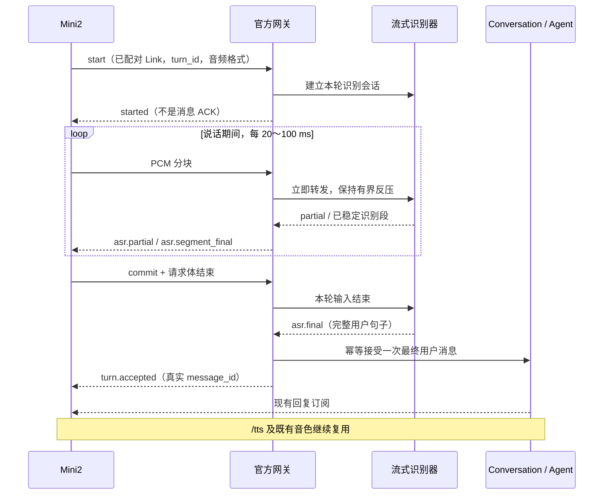

# 2026-11-25：云端流式输入核验与接入要求

结论：**目前可核实的官方设备接口没有提供可直接接入的实时 ASR 契约。**
现有固件的 overlap 是采集和文件上传重叠；`/chat/subscribe` 的 delta 是回复文字，
二者都不等于边录边识别。本轮没有找到可以直接启用的实时识别入口，因此没有把
固件切换到猜测出来的接口。云端内部是否已有未公开能力、生产部署使用什么版本，
仍需云端维护者提供接口及部署信息；不能把公开资料中未发现接口说成内部一定没实现。

本轮核验官方当前主线、在线网关首页及设备已有实测；没有云端源码或运行日志。
下文新增路径和事件均为**待云端实现、联调的建议协议**，不是已有 API。
公开证据及哈希见 [核验数据](data/cloud-streaming-input-audit-20261125.json)。

## 一、查到了什么

| 对象 | 本轮证据 | 能说明什么 |
| --- | --- | --- |
| 官方 SDK 主线 | `cf20c6bc87b6514e3ba97f4a04c00bed86fbc47b` | ARCS/ESP32 仍将 WAV Base64 放进 `/chat/stream` 的 JSON 文件项 |
| 官方应用及契约主线 | `45cc0886917d8d864c957545ea4bbb7c5b89fa83` | 应用转写仍是完整 `VoiceClip` 请求和最终 `{text}` 响应 |
| 在线网关首页 | 本轮 GET 返回 200 | 声明支持回复流及语音，没有提供实时输入/识别协议 |
| 网关实现 | 首页链接的 `server/gadget-gateway/README.md` 返回 404；当前应用 README 说明服务器不在仓库内 | 无法核对生产网关是否聚合完整请求体、何时调用识别器 |
| Mini2 已有验证 | 同一镜像的八轮文件上传、消息 ACK、回复及 TTS | 能验证现有聊天路径，不能验证录音结束前云端已识别 |

官方证据：

- [ARCS 语音文件请求及上传](https://github.com/impoai/impo-gadget-sdk/blob/cf20c6bc87b6514e3ba97f4a04c00bed86fbc47b/arcs/gadget/gadget_voice.c#L43)。文件字段是 `mime_type: audio/wav` 和 `data_base64`；分块发送未改变其文件语义。
- [ESP32 用户文字更新](https://github.com/impoai/impo-gadget-sdk/blob/cf20c6bc87b6514e3ba97f4a04c00bed86fbc47b/esp32/components/impo/impo_chat_link.c#L628)。显示来自 `message.user` 的转写更新，没有独立的 ASR partial/final 接入。
- [应用语音契约](https://github.com/impoai/impo/blob/45cc0886917d8d864c957545ea4bbb7c5b89fa83/contracts/client-protocol.md#L135)。`/voice/transcriptions` 接收完整 Base64 音频，返回最终文字；`/conversation/voice-messages` 完成转写后接受消息并启动回复。这里是应用 API，不能直接拿设备配对凭据调用。
- [Web 实际录音流程](https://github.com/impoai/impo/blob/45cc0886917d8d864c957545ea4bbb7c5b89fa83/web/src/voice-input.ts#L193)。录音块先保存在本地，停止后拼成 Blob 才提交转写；`MediaRecorder.start(1000)` 本身不代表实时上传。
- [旧实时写入接口状态](https://github.com/impoai/impo/blob/45cc0886917d8d864c957545ea4bbb7c5b89fa83/contracts/client-protocol.md#L594)。契约注明 `/listening/segments` 已移除；Rewind 的批次上传不是设备实时聊天入口，也不能据此断言其他内部接口都不存在。
- [服务器不在公开仓库内](https://github.com/impoai/impo/blob/45cc0886917d8d864c957545ea4bbb7c5b89fa83/README.md#L9)；[在线网关说明](https://gadgets.impo.ai/)。在线说明不是生产后端版本或时延证明。

没有做未知路由枚举，没有用未认证的 404 推断认证后能力，也没有把“请求尚未结束时
没有消息事件”当作识别未启动的证明。已有残缺 JSON/取消负向检查仅证明其观察窗口内
没有得到完整消息提交证据；识别器可能不对外发中间结果，不能反推出其内部行为。

## 二、真正流式需要满足什么



**关键是网关在请求体尚未结束时就把音频交给持续工作的识别器。** 如果仍然先
`request.json()`、`arrayBuffer()`、读完整文件或等待 `end_body`，再调用一次性转写，
即使设备每 20 ms 上传，也只是分块传文件。下游转写供应商本身也须支持持续输入；
反复重传完整前缀做一次性识别，不能冒充同一识别会话。

部分结果允许修订。已稳定的段结果也不自动结束整个用户回合，更不能每识别一个短句
就创建一个聊天消息。MVP 只在显式 commit 后提交一次最终用户句子；partial 用于
识别进度，不能触发工具或不可撤销动作。

## 三、给云端的最小改造单

以下为建议 v1。端点名称可由云端调整，语义和验收条件应保持。

| 层 | 必须补的能力 | 交付证据 |
| --- | --- | --- |
| 能力发现 | 在现有设备认证 Link 内提供版本化能力查询，例如 `GET /voice/capabilities`，返回 streaming、格式、语言、限额、协议版本及部署标识 | 当前设备凭据实际取得支持声明；不返回供应商密钥 |
| 网关入口 | 例如 `POST /voice/stream`，请求体持续输入、响应体持续 NDJSON；收到 start 即创建识别会话 | 请求未封口时已有识别结果；网关没有整段缓冲 |
| ASR 适配 | 一个 turn 对应一个持续输入的识别会话；首选 16 kHz/单声道/PCM16LE，明确中文支持和可用区域 | 首段送入、首识别结果、最终结果时间；中途断网和无语音行为 |
| 消息接入 | 最终完整转写幂等写入该设备已有 Conversation，并启动一次 Agent | `turn_id → message_id` 唯一映射，回复父消息沿用现有匹配 |
| 取消和错误 | commit 前取消不创建消息；commit 后取消有明确服务端结果，停止后续生成/工具调度的范围须说明 | 取消确认、状态查询；已发生的工具副作用不能声称被撤销 |
| 可观测性 | 网关、识别、排队、首文字及 TTS 分段耗时 | 同一个非敏感 trace 标识可串联，客户端可见阶段和数值 |

建议能力响应至少包含以下字段。该示例不是探测得到的响应：

```json
{
  "protocol": "impo.voice.v1",
  "streaming_input": true,
  "partial_transcripts": true,
  "formats": [{"encoding": "pcm_s16le", "sample_rate_hz": 16000, "channels": 1}],
  "languages": ["zh-CN"],
  "max_turn_ms": 15000,
  "max_audio_bytes": 480000,
  "max_inflight_audio_bytes": 32000,
  "deployment": "opaque-build-id"
}
```

### 传输与回合语义

- 复用现有 Noise/TLS/设备配对和注册节点绑定。云端不能相信音频正文里任意指定的
  用户、node 或 Conversation；不得要求固件持有账号凭据或 ASR 供应商密钥。
- 先支持裸 PCM，不必等待 Opus。16 kHz PCM 为 32,000 B/s，Base64 为约
  42,667 B/s；改二进制后音频载荷少约 25%，新增帧头开销另算。这是字节收益，
  不是端到端快 25% 的预测。已有 AP 音频链路无需为此换唤醒资源或回答音色。
- 请求使用可跨底层 BodyChunk 拼接解析的记录格式，例如
  `u32_le payload_len | u8 type | payload`。start 是有界 JSON；audio 的 payload
  是 `u32_le seq | u32_le sample_offset | pcm_bytes`；commit/cancel 是有界 JSON。
  不依赖 WebSocket、TLS 或 BodyChunk 的分块边界，先校验长度再分配。
- start 包含 `turn_id`、协议、音频格式、语言和端点模式。audio 必须偶数字节、
  序号连续、采样偏移匹配；超限、缺块和乱序返回明确错误，不静默生成残缺句子。
  commit 包含最终序号和总采样数，之后封口。只有 commit 和输入完整性均有效，
  才能把 ASR 最终文字变成聊天消息；仅连接断开或 EOF 不能隐式提交。
- 第一版保留设备的 1200 ms 端点以隔离变量。识别器可返回段级 endpoint，但不能
  直接替设备提交整轮，以免句中停顿拆成两个问题。更短端点另做完整性 A/B。
- 开始响应、音频接收进度、最终识别和消息接受是四种不同状态。建议事件为
  `voice.started`、`audio.accepted`、`asr.partial`、`asr.segment_final`、`asr.final`、
  `turn.accepted`、`voice.error`。事件含 turn_id、单调 event_seq；识别结果含
  segment_id/revision，最终句子含最终版本，不能把修订文字反复追加。
- 音频接收确认应带最高连续序号和可用窗口；它只说明接收/识别进度，不等于消息
  已接受。必须限制网关待处理队列，并及时传递背压。设备采集不阻塞，PSRAM
  环形队列溢出则该轮显式失败。不能在失联后自动重投语音或创建第二条消息。
- commit 超时状态未知时，用相同 turn_id 查询或重取原结果。云端应明确幂等记录
  的保留期、相同 ID 不同内容的冲突处理及断线状态；相同 ID 绝不重复启动 Agent。
  可提供 `GET /voice/turns/{turn_id}` 和 `POST /voice/turns/{turn_id}/cancel`。

现有官方 [Noise envelope](https://github.com/impoai/impo-gadget-sdk/blob/cf20c6bc87b6514e3ba97f4a04c00bed86fbc47b/linux/src/impogadget/noise/envelope.py#L64)
已分别表示请求、响应、BodyChunk 和结束标记；设备
[响应分发](https://github.com/impoai/impo-gadget-sdk/blob/cf20c6bc87b6514e3ba97f4a04c00bed86fbc47b/esp32/main/noise_control.cpp#L1155)
也没有以“本地已发完请求体”为收到响应的前置条件。这说明可以优先评估复用现有
传输，**不证明生产网关或全部中间层已经支持双向持续处理**，必须联调验证。

Mini2 底层只有三个通用请求槽位。流式输入结束并取得 `turn.accepted` 后及时释放
输入请求，回复继续走已有订阅，TTS 使用另一个槽位；不要再永久增加一个 ASR
订阅。重叠上传、取消和 TTS 的槽位压力须实测，不能靠堆大 SRAM 缓冲解决。

## 四、收益可以确认到什么程度

最新八轮中，结束录音→全部本地排队为 **2.522～4.085 s**，排队完成→消息 ACK 为
**1.244～2.162 s**；ACK→首回复增量为 **4.563～5.790 s**。
真正流式识别可以把音频传输和识别工作前移到用户说话期间，减少结束后的积压和
识别收尾，但当前没有 ASR 开始/结束标记，无法把上述区间拆成上传、识别、网关排队
及模型各自耗时，也不能把它们全部记为流式 ASR 收益。

ACK 后的等待可能包含识别，并不全是模型推理；现有边录边传的收益也不能再与
实时识别收益简单相加。对相同录音重放、同一镜像的 batch / overlap / 真流式三组
应分别比较，先核对完整转写，再统计失败率和首声。

**流式 ASR 单独上线，仍不足以承诺两秒首声。** 同组 TTS 提交→首音频响应体为
**2.873～4.860 s**，已有最短值也超过两秒。云端还须优化第一段可播回复和 TTS
首包，设备沿用已有分段播放及原音色。作为联合调优目标，可把两秒预算分为：

| 用户最后有效语音之后的串行阶段 | 候选预算 |
| --- | ---: |
| 确认说完 | 350 ms |
| 剩余传输、识别收尾及消息接受 | 150 ms |
| Agent 到第一段稳定可播文字 | 600 ms |
| 原音色 TTS 到首 PCM | 650 ms |
| 起播缓冲和实际输出 | 250 ms |
| 合计 | 2000 ms |

以上是待验证预算，不是现有测量或保证；350 ms 端点与当前 1200 ms 不同，存在
截断风险，不能直接作为默认配置。复杂工具问题、弱网和长停顿另外计，不用提示音
冒充有意义的回答首声。

## 五、云端上线前的验收门槛

1. **证明没有等文件收齐：** 用固定中文音频按实时速率发送。第一段是可独立识别的
   完整短句，之后保持请求体不结束至少三秒，再发送第二段独有内容并 commit。
   在 commit 前收到含第一段内容的识别结果，commit 后取得包含第二段的完整最终
   句子。用单一客户端单调时钟记录发送与接收，并与云端 ingress/ASR 分段耗时关联。
   同时核对持续同一 ASR 会话及没有整段缓冲。仅 `voice.started`/音频接收 ACK 不算。
2. 同一录音至少三十对交错对比，保留所有失败与异常；报告用户说完→声学首声的
   P50/P95、转写完整性、重复消息数、收音丢样、欠载及回合关联。声学与驱动日志分别
   统计，不能只选成功或较快的回合；延迟收益需在相同端点条件下比较。
3. 覆盖句中停顿、弱末字、无语音、噪声、15 秒上限、慢网背压、断线、缺块、重复
   commit、冲突 turn_id、取消和旧回合迟到。取消前不创建消息；commit 结果未知时
   不自动新建回合。服务端取消确认和本地停止播放分别记录。
4. 返回或可查询同一 trace 的分段指标：首音频 ingress、ASR 首输入/首结果/最终结果、
   用户消息接受、Agent 排队/开始/首文字、TTS 上游请求/首 PCM 及网关转发首包。
   各服务用自身单调时钟计算持续时间，不直接相减未同步的跨机绝对时间。
5. 在原官方设备凭据、原 Conversation、原 `/tts` 音色和“小周小周”资源下完成实机
   验证，再决定 SDK 默认值。供应商 key、原始录音、转写和完整设备身份不写公开日志。

当前交付是接口核验和云端改造规格；没有伪造可用的流式 SDK、修改设备配置、刷写
新固件或声称取得新的实测收益。云端提供上述能力声明、可调用端点和事件样例后，
才有可联调的设备接入目标。
