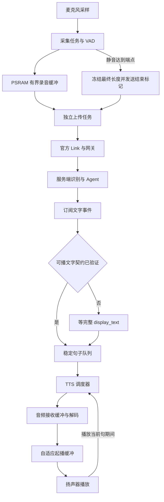

# Impo ARCS Mini 语音延迟优化技术方案

日期：2026-11-24。状态：设计稿，参数与性能门槛为待验证目标。第一阶段实施及独立验收记录见 [实施说明](VOICE_LATENCY_IMPLEMENTATION.md) 与 [验证记录](VOICE_LATENCY_VALIDATION.md)。

目标是缩短用户说完到设备首声的等待，同时保持收音完整、播放连续、回合关联正确和唤醒词打断。采用三步实施：先增加计时和非阻塞的采集上传并行，再引入按句 TTS 与播放缓冲，最后依据服务端追踪优化识别、推理及语音首包。

本方案面向当前官方 Link 路径上的 ARCS Mini 固件。设备继续通过官方国内入口、TLS、WebSocket 和 Noise 会话使用 `/chat/stream`、`/chat/subscribe`、`/tts`。第一阶段复用现有协议；实时识别、压缩音频和稳定可播文字流需要网关或服务端契约配合。

## 1 基线与范围

### 1.1 版本

| 对象 | 参考版本 | 用途 |
| --- | --- | --- |
| 官方 SDK | `f31b7b0f57c8aac7b5de4bbd6dbb1d1fb1c2c1a2` | 本次核对的官方主线快照 |
| 本地固定 SDK | `ad0e6b7527501248631569516483e4845e2e5665` 加项目补丁 | 当前工程的实际依赖 |
| 本地固件工程 | `2de843b` | 方案编写基线，已包含唤醒词打断与回采计数修正 |
| 历史性能样本 | 云宝 `fe3f2eb2…`；Mini2 `4ea8f038…` | 两台设备各两轮，早于新增打断版本 |

历史听测与延迟结果不自动代表 `2de843b` 或未来优化镜像；新基线应在目标设备上重新采样。最新打断版本的主动唤醒打断及新问题听测仍按 [VALIDATION.md](VALIDATION.md) 单独验收。

### 1.2 官方与本地的区别

| 阶段 | 官方 ARCS 快照 | 本地实现 |
| --- | --- | --- |
| 输入 | 收音期间分块上传 WAV Base64 | `0004` 补丁先录完整句，再上传 |
| 端点检测 | 说话后静音 1200 ms | 相同 |
| 文本 | 等 `delta.message_done` 或完整 `message.assistant` | 相同；文字增量不触发播报 |
| 语音 | 完整文字后发 `/tts` | 相同 |
| 播放 | 音频到达后边下载边播放 | `0001` 补丁让短回复收齐，长回复缓存到约 25 秒音频量 |

两个本地补丁分别解决慢上传影响收音和网络抖动导致播放断续的问题。优化时用新的并发和欠载策略替代对应行为，不直接撤销后恢复旧问题。官方分块上传本身不证明服务端能够增量识别。

官方源码：[录音上传](https://github.com/impoai/impo-gadget-sdk/blob/f31b7b0f57c8aac7b5de4bbd6dbb1d1fb1c2c1a2/arcs/gadget/gadget_voice.c#L215)、[消息完成条件](https://github.com/impoai/impo-gadget-sdk/blob/f31b7b0f57c8aac7b5de4bbd6dbb1d1fb1c2c1a2/arcs/gadget/gadget_voice_logic.c#L164)、[TTS](https://github.com/impoai/impo-gadget-sdk/blob/f31b7b0f57c8aac7b5de4bbd6dbb1d1fb1c2c1a2/arcs/gadget/gadget_speech.c#L95)。

### 1.3 已有计时

单位为秒，均从设备结束录音开始计算，不包含此前 1.2 秒的端点静音等待。

| 样本 | 结束录音到接收确认 | 确认到完整文字 | 完整文字到音频可播放 | 合计 |
| --- | ---: | ---: | ---: | ---: |
| 云宝第 1 轮 | 2.445 | 5.157 | 2.842 | 10.444 |
| 云宝第 2 轮 | 2.325 | 4.590 | 2.772 | 9.687 |
| Mini2 第 1 轮 | 3.155 | 8.912 | 2.647 | 14.714 |
| Mini2 第 2 轮 | 7.575 | 4.895 | 2.401 | 14.871 |

每台仅两轮，不能计算有代表性的 P50/P95，也不能直接比较两台设备优劣。接收确认前后尚不能拆出识别、排队与模型各自耗时。音频可播放是缓冲释放时间，实际首声须结合 DMA 与声学测量。

这四轮 TTS 请求到 WAV 头为 1.677～2.679 秒，WAV 头到音频可播放为 0.090～0.721 秒。因此对短回答，缩小音频缓冲的直接收益有限；上传停顿、完整文字等待和 TTS 首包更值得优先测量。WAV 头不是首个 PCM，后续补独立标记。

脱敏数据位于工作区 [latency-breakdown.json](../../outputs/impo-voice-latency-analysis-20261124/latency-breakdown.json)，原始语音、文本及凭据不进入公开方案。

## 2 目标链路

图中的并行点为：采集与上传重叠；文字继续生成与首句 TTS 重叠；当前句播放与下一句 TTS 下载重叠。首版最多一笔活跃 TTS 网络请求，不并发请求整篇回答。

用户等待可拆为：端点检测 + 录音后剩余上传 + 服务端首个可播句子等待 + TTS 首包 + 起播缓冲。流水线只减少不必要的串行等待；对已经在传输、识别或推理中消耗的时间不能重复计算收益。

## 3 P0 计时与回合生命周期

### 3.1 统一关联

增加回合上下文 `voice_turn_ctx`，生命周期由一个协调任务管理。字段包括启动随机标识、单调递增的 `turn_epoch`、Link 会话代次、上传请求句柄、确认后的消息 ID、当前回复消息 ID、取消原因、各阶段时间戳。

所有采集块、请求事件、文字段及音频段都携带回合代次。禁止只用全局布尔量表示新旧回合。保持上传句柄直到完成回调或取消完成；当前上传排队后将 `s_note` 置为 -1 的方式，在并行实现中需要替换，避免失去取消与关联依据。

接收确认前到达的文字事件进入小型有界暂存区，确认后按父消息匹配释放。不同回合、不同会话、缺失必要关联信息的事件不进入可播队列；超限则明确记录并终止该回合播报，不能静默丢掉半个回答后标为成功。

### 3.2 时间戳与指标

| 标记 | 定义 |
| --- | --- |
| `last_voice_sample` | VAD 最后一个有效语音采样的位置，换算到设备单调时钟 |
| `capture_end` | 端点检测完成，录音缓冲封口 |
| `upload_first_tx` / `upload_last_tx` | 首个与最后一个请求体块完成底层发送；仍不代表服务端接受 |
| `upload_queued` | 所有请求体进入本地发送队列 |
| `server_ack` | 收到成功且可解析的回合接收确认 |
| `first_text_delta` / `message_done` | 首个文字增量与完整消息 |
| `first_speakable_segment` | 首个通过关联、稳定性和内容类型检查的句子 |
| `tts_request` / `tts_first_byte` / `tts_first_pcm` | TTS 发起、首个响应体字节与首个有效 PCM，逐段记录 |
| `playback_ready` / `playback_first_dma` | 起播条件满足与首段 PCM 交给实际播放链路 |
| `playback_end` / `cancelled` | 播放完成或取消 |

设备用单调时间计算差值。服务端另记录 ingress、识别开始/结束、排队、模型首段/结束、工具调用、TTS 上游首包及转发首包；服务端用自己的时钟计算区间，通过请求标识关联，不能直接相减未同步的跨机时间戳。

核心指标为用户说完到声学首声。开发阶段同时记录 `capture_end → playback_first_dma`，用来排除 VAD 差异。辅助记录上传余量、发送队列高水位、TLS 慢写、TTS 首 PCM、播放欠载次数与时长、取消延迟、栈余量、PSRAM 和内部堆最大连续块。

日志采用固定字段、异步输出，只记录长度、阶段、耗时及不含身份的关联标识。不要在音频回调里格式化日志；每轮输出摘要，慢路径输出有界明细。

### 3.3 用户状态

增加独立的语音阶段查询或回调，不改变官方注册协议。SDK 保留旧状态兼容映射，屏幕按新阶段显示：

| 条件 | 文案 |
| --- | --- |
| 正在采集，即使后台同时上传 | 我在听 |
| 采集结束，剩余音频未确认 | 正在上传 |
| 已确认，尚无可播回复 | 等待回复 |
| TTS 已请求，尚未首声 | 准备语音 |
| 实际播放链路已启动 | 正在回答 |
| 播放欠载暂停 | 缓冲中 |
| 超时、断连或取消 | 对应明确状态 |

新中文字进入产品字体生成与布局检查。更准确的状态显示不计入性能收益。

## 4 P1 采集上传并行

### 4.1 任务与缓冲

保留现有 1 秒麦克风抖动缓冲和最多 15 秒、约 480 KB 的 PSRAM 录音区，将整句缓存改为单生产者、单消费者的追加式缓冲：

1. 音频回调只做有界拷贝并立即返回；独立采集任务持续做 VAD、写 PCM、发布已写入位置。
2. 新上传任务读取已发布的数据并编码发送。正常工作复用现有 6144 字节 PCM 编码块、8192 字节 Base64 和 Link 内 2048 字节分块；不足整块时保留尾部，最终再做 Base64 padding，不能每个任意短块都补 `=` 后继续拼接。
3. 写入位置、封口状态与取消状态用 RTOS 同步原语或经验证的原子发布；网络等待期间不持有采集锁。
4. 采集优先于上传，网络任务只调用现有 Link 请求队列，不另开 TLS 线程同时操作同一连接。
5. 在检测到有效语音后再打开上传；此前短暂预录保留在缓存中，减少纯静音请求。15 秒上限沿用，超限、丢样、取消均有明确处理。

最坏情况下保留完整录音，上传落后不会让采集环覆盖尚未上传的数据。容量耗尽时停止录音并结束该回合，不丢弃中间数据后继续伪装完整音频。只有消费者退出并释放引用后才能复用录音区。

### 4.2 请求体兼容门槛

录音前无法知道准确 WAV 长度，不能继续使用本地整句模式的精确 RIFF/data 长度再提前发送。候选方案复用官方 ARCS 的未知长度 WAV 头，在端点完成后发完尾部音频及 JSON 结束标记。

上线前用当前官方网关验证：未知长度 WAV 可接受；Base64 跨块一致；无结束标记或主动取消不提交残缺消息；只有完整请求被确认；一个请求只产生一笔消息。该门槛未通过时保持 `batch` 模式，或与官方约定流式上传协议。不能在某轮部分提交后改发整句来自动回退，否则可能产生重复会话消息。

`capture_end` 后计算剩余字节；将“录音后剩余上传耗时”作为独立收益指标。服务端如果仍等完整 WAV 才识别，这一步主要消除录音后的传输等待，不承诺提前完成识别。

### 4.3 端点检测

先保持 1200 ms，单独验证并行上传。之后增加产品配置，正常对话候选为 800 ms，保守模式仍为 1200 ms。相同语音判定下理论上减少 400 ms 尾部等待；有噪声或句中停顿时以实际结果为准。

用包含慢速说话、数字、中文停顿、背景人声的语料验收。600 ms 只作为实验档。阈值、声学模型和唤醒词不随此次端点参数变更隐式调整。

## 5 P2 按句 TTS 与播放调度

### 5.1 可播文字契约

不能把所有 `delta.text_append` 直接念出来。先验证事件是否属于当前回合的用户可见回答，是否只有追加而不会修订，是否包含工具说明、代码或仅在最终 `display_text` 才清理的内容。`display_text_ready=false` 及缺乏稳定性保证时不提前播。

只要这一契约不能成立，就保留整条 `display_text` 路径；同时向官方提出稳定可播文字事件的协议要求：回合关联、消息 ID、单调序号、已提交文字范围、消息完成和整个回合完成。以上为拟议能力，不是已确认存在的事件。

通过门槛后增加 `gadget_voice_text` 分句器：按 `。！？`、可靠换行和明确分句边界提交；识别小数、缩写、引号与 UTF-8 边界。首句候选长度 8～40 个字符，后续约 20～80 个字符，最终短句立即提交。无标点时只有在已确认不可修订的边界切分；等待时间到期本身不使文字变得可播。

以 `(turn_epoch, message_id, segment_index)` 去重。为已播、已排队和尚未提交文字维护独立偏移；后续完整消息只补未提交后缀，不能整篇再念一遍。若最终文本与已播前缀不一致，记录协议不兼容并停止该模式；已播声音无法撤回，不声称可无损回退。

### 5.2 TTS 队列替代单例覆盖

当前 `gadget_speech_say()` 会取消旧请求，`on_begin()` 会开始新播放代次。因此分句实现需要内部队列接口和请求上下文，不是对每段反复调用原函数。

建议内部接口为 `speech_enqueue(turn_epoch, message_id, segment_index, text)`、`speech_finish_message(...)`、`speech_cancel_turn(...)`。每段拥有独立 WAV 解析器、接收状态和音频归属。现有公开 `say()` 保留显式替换语义，通过统一仲裁器执行；外部播报中断语音会话时，应先取消原回合队列，不能把两类声音混入同一个缓冲。

当前 Link sink 回调不携带调用方上下文，需要增加内部带 `ctx` 的接口或等效请求映射，并保留旧接口适配。回调绑定请求槽位代次与回合代次；取消后收到的旧回调不能读取新请求的解析器。上下文只在终结回调完成、音频任务释放引用后回收。

首版允许一笔活跃 TTS 网络请求。当前段请求体和响应结束、请求槽位释放后，可以在其音频尚在播放时下载下一段。相邻段在同一回合的 PCM 环中按顺序衔接，记录段边界；开始下一段下载不能清空当前 PCM。

底层 `REQ_MAX_STREAMS=3`，按订阅、上传、TTS 分配。ARCS 本地槽位数为 4 不代表底层可并发 4 笔请求。预取只在上传结束且槽位确实释放后开始；首版不增加这个全局上限。

### 5.3 首句与后续句的权衡

很短的首句虽然能早出声，但其播放时间可能短于下一笔 TTS 的约两秒首包等待，产生句间长停顿。首版仅缩短第一段，后续合并相邻句，使播放与下一段生成有足够重叠；同时记录句间间隔、TTS 请求数及计费影响。

纯“好的”“嗯”等填充音不计为有效回答首声。对只有“五。”一类短回答，按句优化收益很小，其重点是上传、服务端等待与 TTS 首包。对长解释，按句优化潜在收益更大。

### 5.4 音频缓冲策略

保留现有约 960 KB 的 16 kHz 单声道 PCM 环，新增可配置起播阈值，实验初值为 800 ms，范围 600～2000 ms。短音频在确认完整后，即使不足阈值也立即释放。

按 PCM 到达间隔、最近欠载和下载速率调节下一次起播阈值；没有足够样本时使用初值，不把 WAV 头到达当成持续带宽。若预计下载长期低于播放速率，短回复退回收齐模式；长回复使用明确的再缓冲状态或中止反馈，不能无限增大缓存。

正在播放时不跳过样本追赶，也不从头重复播放。欠载时在 DMA 边界补静音并进入再缓冲；恢复后从原样本位置继续。淡入淡出、功放保持与降噪需要实际听测，不能只以“没有软件错误”验收。

### 5.5 接收回调不能阻塞链路

当前 TTS sink 在 Link 任务中直接解析 WAV、调用可能等待的音频写入。并行化后增加有界音频 ingress 缓冲，回调只快速拷贝；解码与重采样移到音频任务。

该解耦属于实施门槛：不能让满 PCM 环阻塞订阅、取消及心跳。建议预留 64 KiB ingress，并对照实际最大响应块验证容量。接近播放环高水位时不启动下一笔 TTS。若活跃响应仍超过容量，在没有按流接收背压支持时明确失败该段，不静默丢字节、不无限阻塞全连接。长音频的稳定背压需与共享 Link 实现一并验证。

## 6 打断 取消与恢复

整个回合采用多个并行子状态：采集、上传、文字接收、TTS、播放。外层协调器维护 `IDLE`、`ACTIVE`、`CANCELLING`、`FINISHED`，界面状态由实际阶段派生。不能用互斥的单状态枚举描述同时收音和上传。

取消顺序为：使旧回合代次失效 → 停止本地音频与清空未播队列 → 给网络任务发送取消 → 回收旧请求与缓冲引用 → 麦克风交接与新回合。已经进入 DAC 的尾音单独计时；本地停止不应等待最长 15 秒的 TLS 写调用返回。

现有唤醒词打断规则继续适用：播放或等待回答时检测唤醒词，录音期间暂停检测；原机双声道中左声道为麦克风、右声道为扬声器回采，云端录音为单声道。保持 `0015`、`0016` 的所有权和总样本数处理，并重新验证 0.1.6 与 0.1.8。

取消后的迟到文字和 PCM 同时校验回合代次及会话代次。断网或结果未知时不自动重发用户问题；本地取消也不表示云端 Agent 或其工具动作已经取消。若需要真正的任务取消，必须增加经过官方确认的服务端操作。

订阅重建与请求失败处理从当前阻塞式回合等待中独立出来，或由协调器事件驱动，避免等待回复时无法补订阅。重连后的回合是否能续收取决于服务端重放和游标契约；没有该契约时结束旧回合，不能把新订阅上的任意回复接回来。

播放完后现有约 3 秒静默观察还用于等待后续消息。只有服务端明确给出整个回合完成事件，且 TTS/音频队列都空，才缩短这段等待。`message_done` 只说明一条消息完成，不等同于整个 Agent 回合结束。

## 7 网络与服务端优化

### 7.1 设备传输

TCP_NODELAY、非阻塞接收 BIO 已存在，应保留并回归，不把重复开启列为新收益。先记录队列等待、单次 TLS 写调用、WANT_READ/WANT_WRITE 次数、收发进展和断线原因，再结合中继端证据区分设备调度与网络停顿。

如果证据证明单个 TLS 写重试占住共享会话，评估将发送改为可恢复状态机，在有界时间片后让出给接收、取消与心跳。mbedTLS 的重试缓冲和长度必须保持合法，Noise/WS 帧在成功前保持原顺序与存活，不允许新任务并发写同一 TLS 对象。此改造影响共享传输，单独提交并运行 ARCS 与 ESP32 受影响测试。

第一轮实验保留现有失败预算，仅增加无进展反馈。之后按分阶段 P95 设置提交、回复、TTS 和播放期限；延长总超时不是提速，简单缩短总超时也不是成功延迟优化。

### 7.2 官方服务端协同

| 项目 | 官方需确认或提供的内容 | 达成后收益 |
| --- | --- | --- |
| 分段追踪 | 同一回合的识别、排队、模型首段、工具、TTS 首包区间 | 明确设备与云端耗时占比 |
| 稳定可播文字 | 只追加、可播范围、序号、父消息关联及完成事件 | 安全地按句起播与取消 |
| TTS 流式透传 | 上游首 PCM 产生后及时下发，不在网关等待完整音频 | 缩短语音首包及长回复等待 |
| 语音回答策略 | 简短回答、首句尽早给出；需工具时等待真实结果 | 减少无关文字与不必要的多轮工作 |
| 模型与 TTS 后端选择 | 以质量一致的同语料对比延迟、成本与识别准确率 | 降低云端主要耗时 |
| 真正的流式识别 | 增量音频、端点提交和取消协议 | 将识别与收音重叠 |
| 二进制或压缩音频 | 采样率、编码、分帧和解码兼容约定 | 减少带宽与编码开销 |

原始 16 kHz PCM 为 32,000 B/s，Base64 约 42,667 B/s。去掉 Base64 相对现有 Base64 字节量约减少 25%，不是 33%；压缩收益需要选定编码后实测。压缩和新传输格式作为后续阶段，先验证当前协议下的流水线。

国内中继的作用是传输与路由，不能据此推断识别、Agent 和 TTS 也在国内运行。既有连接可复用，不把每轮延迟都算作新 TLS 握手。

## 8 模块与资源预算

| 模块 | 计划改动 |
| --- | --- |
| `gadget_voice.c` | 回合上下文、协调器、采集与上传分离、取消和订阅恢复 |
| `gadget_voice_logic.[ch]` | 可配置端点、消息关联与去重；新增纯逻辑分句模块 |
| `gadget_speech.c` | 单例请求改为有归属的 TTS 队列及请求上下文 |
| `gadget_sound.c` | 同一回合连续 PCM、段边界、阈值起播与再缓冲 |
| `impo_link_streams.c` | 生命周期、分阶段计时、快速 sink、请求槽位使用约束 |
| `noise_control.cpp` / `plat_tls.c` | 先诊断；有证据时再改有界发送调度 |
| `sdk/include` / `sdk/src` | 产品级语音配置、阶段查询与脱敏统计接口 |
| `tools/product.py` / 产品 JSON | 配置校验、生成头文件及构建元数据 |
| 屏幕组件 | 新阶段文案、字形与布局 |
| `tests/` | 真实状态机、慢网、取消、缓冲与兼容性测试 |

计划新增接口与字段尚未实现，不能直接写进当前产品 JSON。建议独立开关：`upload_mode=batch|overlap`、`reply_mode=full|sentence`、`playback_mode=complete|adaptive`、`endpoint_pause_ms`、`prefill_ms`。先生成独立候选配置，缺省值保持已验收行为；只在回合之间切换。

新增模块通过 `sdk/` 组件与可复核补丁交付；不要只修改生成的 `upstream/` 工作目录。公共接口复用产品配置，不将模型、产品名或网络凭据写入通用实现。通过 `tools/prepare_sdk.py` 在干净固定上游上应用，并验证重复准备与旧版本升级。

资源初始约束如下，属于实现预算，需链接图和运行高水位核验：

| 资源 | 预算 |
| --- | --- |
| 麦克风缓冲 | 复用约 32 KB |
| 录音缓冲 | 复用约 480 KB，最多 15 秒 |
| 播放 PCM 环 | 复用约 960 KB，最多 30 秒 |
| 新音频 ingress | 64 KiB PSRAM |
| 文字与段元数据 | 合计不超过约 32 KiB PSRAM；建议 16 KiB 文本池与有界段索引 |
| 新任务栈 | 内部 SRAM 增量初始控制在 8 KiB 内；实测栈余量后调整或复用任务 |
| 请求并发 | 沿用底层 3 个请求流；最多一笔活跃 TTS |

文字池与队列满时明确结束播报并记录原因，不阻塞 Link、不悄悄丢段。当前内部 SRAM 紧张，不能把大数组放进静态内部区，也不能为加速盲目扩大共享发送队列。

## 9 实施与验收

### 9.1 分批交付

| 批次 | 内容 | 退出条件 |
| --- | --- | --- |
| A | P0 计时、阶段显示、回合关联及取消上下文 | 能解释一轮各阶段；原功能行为不回退 |
| B | 独立上传任务、未知长度 WAV 兼容、慢网背压 | 采集零丢样；上传与收音重叠；无重复提交 |
| C | 可配置端点与自适应播放 | 同语料端点完整；首声改善；欠载不增加 |
| D | 可播文字契约、分句器、TTS 队列与预取 | 首句更早；没有重复/漏播、串回合或长句间停顿 |
| E | 服务端首包、识别及可选传输协议优化 | 用端云关联追踪解释额外收益 |

可以在同一次方案实施中准备多个批次，但实机 A/B 每次只改变一组开关。批次 D 在契约未确认时保留 `full` 模式，不以未经验证的文字增量作为正式答案播报。

### 9.2 功能测试

主机测试执行实际模块，重点覆盖：慢写 6 秒/15 秒时采集不被阻塞；上传中的取消及未知结果；末块 Base64 和 WAV 长度；队列满与内存不足；ACK 与回复乱序；重复/断线重放事件；UTF-8 跨块和最终文本修订；TTS 未首包、下载中、播放中的取消；旧 PCM 回调；短 WAV、未知长度 WAV、长于 30 秒音频；连续对话与尾音交接。

新增 TTS 接收任务须覆盖满环背压及订阅/心跳持续进展。改动 TLS 调度时执行真实 mbedTLS 状态机测试，并检查重试 buffer 生命周期，不用只返回预设结果的空 mock 代替。

执行项目 `tests/run.sh`、相关上游 ARCS 主机测试及共享传输受影响测试。分别构建 0.1.6 默认产品、0.1.8 Mini2 产品、按键示例；核验 CP 元数据、归档、SRAM、栈和 PSRAM。设计稿编写时仅新增文档，没有执行或宣称上述实施检查已经通过；后续实施结果单独记录于 [VOICE_LATENCY_VALIDATION.md](VOICE_LATENCY_VALIDATION.md)。

### 9.3 性能与声学验收

先在每台目标设备、每种主要模式做至少 30 轮探索；最终候选每台至少 100 轮，与同设备、同网络、同音频集的基线交错比较。测试集包含短问短答、长解释、工具调用、长停顿、背景噪声和连续追问。统计分别报告，不把工具长任务混入普通聊天的目标。

记录设备身份、AP/SDK 版本、镜像 SHA256、实际国内中继或直连路径、信号、模型配置和会话历史条件。两台设备不混合计算分位数；超时、失败、取消和欠载单列，不能只保留成功快速样本。P95 报告样本量，100 轮仍是验收样本而非长期稳定性证明。

以下为拟定验收目标，不是目前能力承诺：

| 指标 | 目标或判断方法 |
| --- | --- |
| 普通聊天首声 | B/C 批次后相对同设备新基线 P50 改善至少 20%，P95 不恶化；失败率同时报告 |
| 长回答首句 | D 批次后相对完整消息模式 P50 改善至少 30%；句间停顿不抵消收益 |
| 端云联合目标 | 以说完到有效回答首声 P50 ≤ 6 秒、P95 ≤ 10 秒为优化预算，待服务端测量后确认可达性 |
| 语音完整性 | 指定语料无丢样、截尾、重复或漏播；保留人工听测记录 |
| 打断 | 从软件接受打断到本地停止首版目标 ≤ 300 ms；唤醒识别耗时另计，且不慢于同设备基线 |
| 稳定性 | 无新增重启、失配、陈旧回复或跨回合音频；播放欠载不高于基线 |

真实首声通过外部声学录音或可校准采集确认，固件 `playback_first_dma` 是软件指标。播放成功、烧录读回和人耳听到分别记录；性能测试不能覆盖掉唤醒、回声及打断验收。

### 9.4 回退

每批候选保留独立产物及语音配置。回退先切回保守模式并在回合间生效，不能在未知提交中自动重发；需要回退镜像时按 [FLASHING.md](FLASHING.md) 核对当前设备、保留 AP/资源/配对，执行 CP 核验。

历史已验收固件只作为对应设备、对应功能的回退候选。回退普通问答版本可能同时移除后续打断功能，必须在发布清单中明确，不把功能回退隐藏在延迟优化中。

## 10 方案决策

先落地 A 和 B：把阶段看清，并消除网络慢写对收音任务的影响。C 以小步 A/B 选择端点和起播阈值。D 的关键是稳定可播文字与 TTS 队列，优先服务长回答。E 则针对现有记录中占比明显的云端等待与 TTS 首包推进。

最大不确定性是服务端首段文字与首个 PCM 何时可用。只有拿到对应区间，才能把目标拆成可验收的设备预算和云端预算；当前四个历史样本不足以承诺把所有问答降到固定秒数。
