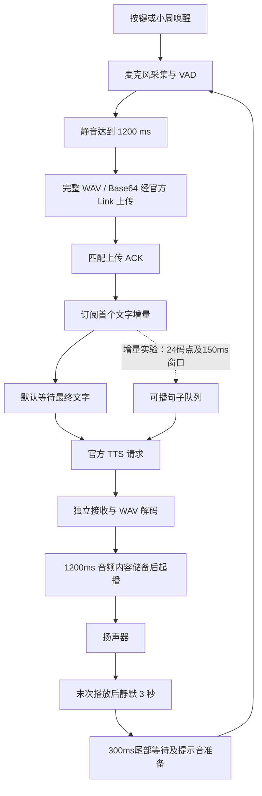

# 2026-11-25 当前语音链路与剩余优化空间

结论：剩余重点是上传、收音端点及轮间衔接。当前已完成的增量和播放优化解决了
部分串行等待，仍不足以把十几秒的完整首声降到几秒。本次核对当前源码和最新八轮
数据，形成下一步改造顺序，没有修改固件、设备配置或新增语音测试。

后续已核对官方当前主线和在线网关说明：未建立设备可调用的实时 ASR 契约。
云端接口、处理流程及证明音频未结束就已识别的验收条件见
[云端流式输入核验](CLOUD_STREAMING_INPUT_AUDIT_20261125.md)。

## 当前实际链路

以下默认值对应刚完成八轮测试后恢复的配置：batch/1200、全文回复、
adaptive/1200/full。边录边传及生成期间的增量播报均为可选实验模式。

边录边传的已有实现可把 D 与 B/C 重叠，但尚未提升为默认。1200 ms 起播阈值指
已解码音频内容长度，不是强制等待 1200 ms 墙钟时间。长连接会话由官方 Link 复用，
没有本组每轮重新建立 DNS/TLS 连接的证据。

## 最新数据把等待进一步拆开了

最新八轮中 ACK→首个文字增量为 **4.563～5.790 s**；首个增量→最终文字为
**0.555～1.974 s**。因此生成期间播报只能重叠后一部分，不能省掉首个增量之前的
四五秒。ACK 不代表识别结束，首增量等待不能直接称为模型推理耗时。

用八轮中的次序 5、全文模式这一条做完整分解，所有设备区间可以严格相加：

| 顺序 | 阶段 | 实测 |
| --- | --- | ---: |
| 1 | 最后有效语音→采集结束 | 1.187 s |
| 2 | 采集结束→匹配 ACK | 3.971 s |
| 3 | ACK→首个文字增量 | 4.808 s |
| 4 | 首个增量→最终文字 | 1.486 s |
| 5 | 最终文字→提交 TTS | 0.089 s |
| 6 | TTS 提交→首个音频响应体 | 4.506 s |
| 7 | 首响应体→首 PCM | 0.005 s |
| 8 | 首 PCM→驱动接受 | 0.319 s |
| | **设备合计** | **16.371 s** |
| | **独立录音测得的首声间隔** | **16.593 s** |

在这一条中，第 2、3、4、6 项合计 14.771 s，占设备合计约 90.2%，但这些区间
包含本地排队和传输，不能称为“云端占 90.2%”。此例不是新的均值或 P50。
增量模式中 TTS 可以早于最终文字，不能照此串行相加。

## 优先级与可以改的地方

| 优先级 | 改造点 | 收益边界 | 状态 |
| --- | --- | --- | --- |
| P0 | 请求排队、实际发送、响应头与首包分别计时，保留已完成回合快照 | 让后续优化可归因，本身不算提速 | 当前缺实际发送边界，整套增量摘要 0/8 完整 |
| P1 | batch 上传裁掉确认静音，保留末字保护 | 试验裁 1 秒可少约 15% 音频；省时待测 | 尚未实施 |
| P1 | VAD 抗脉冲及端点置信度 | 减少噪声额外延长收音；再评估 900/1200 | 尚未实施，800 ms 曾截断句中停顿 |
| P1 | 轮间等待由固定 3 秒改为有条件快速结束 | 3 秒→0.5 秒可少 2.5 秒轮间等待，不影响首轮首声 | 尚未实施，须有结束/迟到回复策略 |
| P1 | 合并 WebSocket/TLS 小写入，定位发送反压 | 有机会降低上传和共享连接阻塞，收益未测 | 当前为 512 字节掩码分块写入 |
| P2 | 在修正后的 TLS 路径上补齐 overlap 稳定性验证 | 可把更多上传放到说话期间，潜力比微调解码大 | 代码已有，历史失败后的验收尚未补齐 |
| P2 | 长回答的最终尾部继续有界分段、按缓冲余量预取 | 改善长回答连续性，不能套成短回答首声收益 | 目前最终尾部仍可能一次提交大段 TTS |
| P3 | 增量合并窗口、100 ms 协调轮询及起播阈值微调 | 本地可争取百毫秒量级，受断档约束 | 不作为当前主攻方向 |
| 外部依赖 | 首个文字增量和 TTS 首包的上游等待 | 可能涉及数秒，但设备日志不能拆出具体责任 | 需要服务端契约/配置或追踪配合 |

### 1. 保留端点判断，减少上传的空白音频

`gadget_voice.c` 每帧都写进录音，batch 在端点结束后上传整个 WAV，包括末尾用于
判定说完的约 1200 ms。可单独实验：仍等待 1200 ms 确认结束，保留 200～300 ms
末字保护，仅裁去验证为静音的余段，再更新 WAV 长度和发布长度。

以次序 5 为例，209,920 B PCM 对应 6.56 秒，Base64 连同 WAV 头约 279,952 字符。
裁去已确认静音的 1 秒，少 32,000 B PCM、约 42,667 个 Base64 字符，即约 15.24%
音频量。这只减少请求体，不代表端点少等 1 秒，也不能把总耗时直接按 15% 缩短。

第一版只适用于尚未开始发送的 batch，验证弱尾音、短末字和连续说话不截尾。
前导静音裁剪另需预录保护，尤其不能把校准期间提早说出的词当成静音删掉；
overlap 已发出的数据不能用缩短长度的方式撤回。

### 2. VAD 有明确的抗噪改造空间

当前 `gadget_voice_logic.c:36` 起，只要一个 20 ms 帧的 RMS 高于阈值，立即把
`quiet_ms` 清零。300 ms 门槛仅用于累计确认曾听到说话；它不要求每次重置静音
都有连续 300 ms 语音，而且 `loud_ms` 跨静音累计。阈值来自最初 500 ms 的最小
噪声帧，此后没有持续跟踪背景变化。

所以瞬时较响声音有机会把端点反复推后。最新一轮 VAD 尾部比固定语料多
1065 ms；源码机制与这种拖延相容，但不能据此认定现场具体是键盘声或某个声源。
可实验有迟滞的起止判断、短时窗口平滑、仅在可靠静音时更新噪声底，并保留弱尾音。
不能简单规定“300 ms 以下一律不算语音”，否则短字和短尾音也会被忽略。
能量 VAD 本身不能可靠区分用户与其他说话者，背景人声仍需另外验证。

抗噪和端点时长应分开 A/B：先保持 1200 ms 验证完整性，再考虑 900 ms 候选。
后者在相同判定下直接少等 300 ms，实际收益和截尾风险须实测。

### 3. 固定三秒等待影响下一轮衔接

`gadget_voice.c` 的 `TURN_QUIET_MS=3000`，语音播放空闲且队列空后仍等待该时间；
下一轮再等 300 ms 尾部、提示音与 150 ms 准备。它解释了回答结束后约 3.5 秒的
迟钝，是首声延迟之外的另一项用户体验指标。

候选 500 ms 安静窗口相对固定 3000 ms 少 2500 ms，但须先明确整个 Agent 回合
结束，或设计旧回合迟到回复的保留、路由和打断规则。`delta.message_done` 只表示
单条消息完成，不足以证明不会再有工具结果或后续消息；本组一轮一条回复也不是
协议保证。不能仅改一个常量后宣称已经安全完成。现有 DAC 尾部保护须另行验收。

### 4. 传输应先补证据，再改写入粒度

当前 Link 外层按 2048 B 入队，官方 small-session 档请求队列为 6 项、body
预算 4096 B。WebSocket 写函数先单独发送帧头，再将掩码后的 payload 每 512 B
调用 TLS；TLS 出站记录容量为 4096 B。存在把帧头及更多 payload 放入有界
PSRAM 暂存、减少 TLS 调用/记录的实验空间。

但减少写调用不等于降低 RTT，`TCP_NODELAY` 已经开启。不能把“加大队列”当作
已修复链路，更不能切换整个内存档而使接收帧容量变小。需要记录队列等待、实际
首/末发送、WANT 重试、TLS 写次数/字节和响应头时刻，区分瓶颈是发送效率还是
对端反压。共享会话线程当前会等待一次写完成，慢写也可能推迟其他流的接收处理。

overlap 的采集解耦代码已经存在；在曾有 TLS 失败的背景下，需要重新补齐完整
对照和失败验收，再决定默认值，不应把“已有实现”误写成“当前已启用”。

### 5. TTS 与长回答的剩余边界

本组 TTS 提交→首音频体为 2.873～4.860 秒，而首体→首 PCM 只有 1～5 ms。
下一步应拆出实际请求发送及状态头时间，判断到底等在本地还是请求外部；不能
仅凭首包慢就断言 TTS 供应商慢。首增量之前的 4.6～5.8 秒也不能靠设备念得更早消除。

增量首段 150 ms 合并与 100 ms 协调轮询还能减少部分本地等待，但应同时检查
欠载，不能重现早期候选的 1.308 秒断档。已有四轮提前 0.400～1.095 秒提交，
不能继续把整个 ACK→最终文字都算作未来可省空间。

另外，`impo_arcs_reply_probe_take()` 在最终文字到达后一次取完剩余后缀，
`gadget_speech.c` 在 streaming 模式下又绕过完整文本分句。若剩余回答很长，仍
可能成为一个长 TTS 请求。30 秒 PCM 环与 64 KiB ingress 是有限缓冲，下载持续
快于播放时存在溢出风险；最新短回答八轮没有覆盖这一情况。这是需要有界分段、
余量预取及慢网/长回答验证的代码审查发现，不是本组已发生的故障。

45 秒无进展及全文模式一次起播前重试还会放大异常无声期。改善健康判断与有界
退出属于失败体验优化，不算正常回答提速，也不重发状态未知的聊天问题。

## 建议实施顺序与验收

先补齐已完成回合快照与请求发送边界，同时准备 batch 尾静音裁剪及 VAD 抗噪
两个独立候选；每次只改一个变量验证。轮间快速结束另作独立实验，单独量“播放
结束→下一轮可说话”，避免把它算进“说完→首声”。随后验证写入合并、overlap
稳定性及长回答分段，最后再微调百毫秒级窗口。

每个候选均记录实际输入完整性、一次消息提交、声学首声、欠载、取消和失败，
不同固件、音量及语料分别统计。没有实测的候选收益保持为空值，不把理论字节
削减或单组 1.080 秒差值升级成产品承诺。

依据：[最新八轮验证](INCREMENTAL_REPLY_VALIDATION_20261125.md)、
[固定字段推导](data/voice-optimization-review-20261125.json)、
[此前全链路分析](VOICE_FULL_CHAIN_ANALYSIS_20261125.md)。

## 小周相对云宝、小聆的体感差异：已有证据能归因到哪里

按最后一次留存配置，小周采用 adaptive/1200/full；云宝、小聆的历史实机日志及
产品缺省为 complete：较短回答收齐全部 PCM，长回答储备约 25 秒音频再起播。
因此最有依据的优势在**首 PCM 已到以后，到真正开始输出之前的缓冲等待**。
这不是唤醒词本身令云端变快。本次离线核对没有重新查询三台当前运行配置，不能
把产品缺省或旧日志当成三台此刻的实机状态。

可隔离播放策略的证据来自先前同机、同镜像、固定 38 码点文字的 20 轮交错测试。
它不是三台设备的 A/B，也不是后来增量验证镜像的重新验收。原音色、官方 TTS、
每轮一笔请求；两组各 10 次均完成、无欠载。以下设备区间覆盖全部 20 次：

| 区间中位数 | complete | adaptive/1200/full | 含义 |
| --- | ---: | ---: | --- |
| TTS 提交→首响应体 | 3.606 s | 3.872 s | 没有显示远端首包的稳定提速 |
| 首响应体→首 PCM | 3.5 ms | 3.0 ms | 解码首块开销很小 |
| 首 PCM→驱动首次接受 | 3.538 s | 0.487 s | 主要省掉了等待后续音频的时间 |
| TTS 提交→驱动首次接受 | 7.274 s | 4.190 s | 整个 TTS 到驱动约少 3.084 s |
| 命令→声学首声 P50 | 7.959 s | 4.756 s | 声学有效分别 7/10、8/10，点估计少 3.203 s |

区间中位数不能相加。按每个交错循环先求 complete 减 adaptive 的差值，再取
10 对中位数，首包差只有 **24 ms**，首 PCM 后缓冲差为 **3.273 s**，提交到驱动
差为 **3.344 s**。三种差值也不能直接相加；它们共同支持收益主要位于首 PCM
之后，并未证明云端合成模型变快。两次相同文字的合成波形和长度也不是逐样本相同。

1200 ms 是已储备的音频内容时长，不是强制等待 1200 ms 墙钟。网络能较快送来
1.2 秒内容时，约半秒墙钟即可起播，其余音频边收边播。

收益随回答长度变化。另一个固定 18 码点短文本，各 4 次的配对缓冲差中位数为
**0.965 s**，提交到驱动差为 **1.169 s**。声学有效 complete 仅 2/4、adaptive 4/4，
不能把其声学分位数当作稳健结论。对于不足约 1.2 秒的极短回答，两种策略都可能
等到完整音频才释放，不能承诺也快三秒；较长回答更容易体现提前起播的优势。

其他阶段目前不应计入小周的已确认优势：

- **收音端点：** 相关产品/历史实现均为 1200 ms；没有三台同声场的最后有效语音
  对齐样本，尚不能判断噪声造成的额外尾部差异，更没有独立的唤醒触发延迟对照。
- **上传：** 小周最后恢复的是 batch，overlap 没有作为默认。历史 overlap 同机
  探索的收益不能算作这次默认使用时的收益。旧云宝录音只有约 2.8～3.1 秒，最新
  小周固定问题录音约 6.5 秒；其上传和 ACK 区间不能直接比较设备快慢。
- **云端识别和模型：** 缺 ASR 分段追踪，也无三台相同问题和会话条件的对照。
  小周最新 ACK→首增量仍为 4.563～5.790 秒，没有证据证明这部分更快。
- **生成一句就播一句：** 增量实验的提前提交为 0.400～1.095 秒，但最终恢复全文。
  因此不能用它解释默认配置的优势，也不能把它与播放 A/B 的三秒直接相加。
- **网络中继：** 云宝、小聆也已有国内入口验收；早先 Mac 新建连接的直连/中继
  `/health` 探测不是三台每轮语音对照，不能归成小周独享的网络收益。

历史两台各两轮的旧基线既不是相同录音，也不是相同回答长度，甚至没有声学首声
标记；它不能为今天三台排快慢顺序。当前可支持的判断是：**提前起播是最有证据的
体验优势，典型中等回答的同机测试省约三秒，短回答收益更小；三台完整对话的差距
尚不能精确分摊。**

复算数据：[三台体验差异归因](data/cross-device-latency-attribution-20261125.json)。
原始对照：[20 轮播放测试](data/playback-20261125-release-matched-20.json)、
[8 轮短文本](data/playback-20261125-release-short-8.json)。本次没有新增语音请求、
修改配置或刷写固件。
